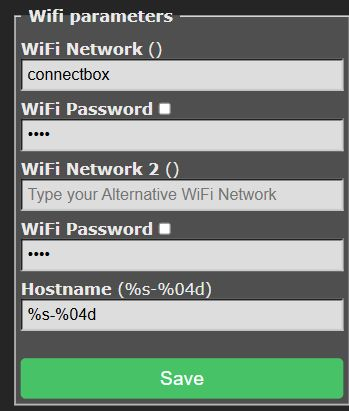
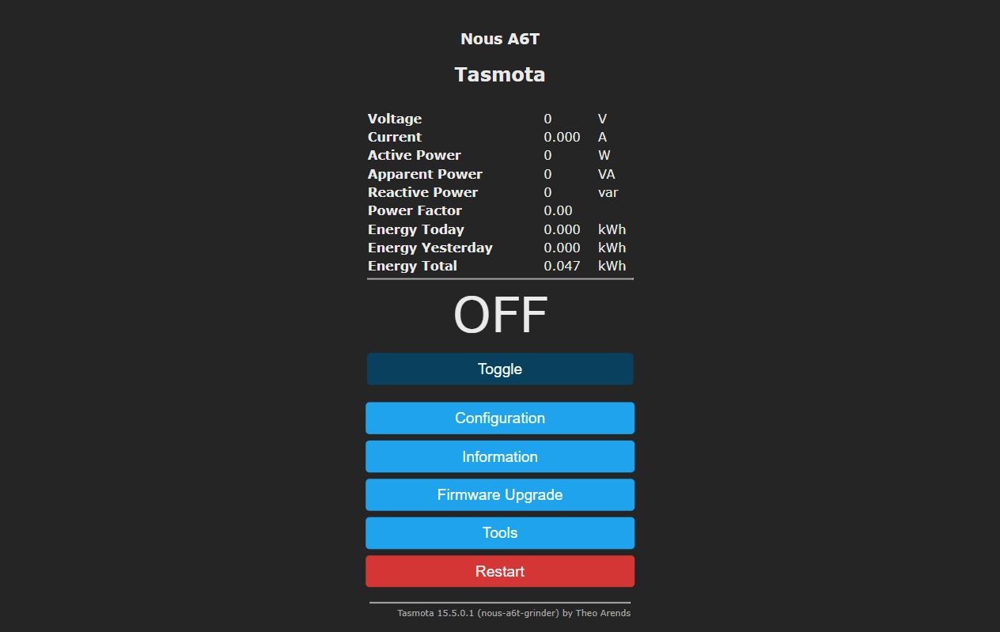
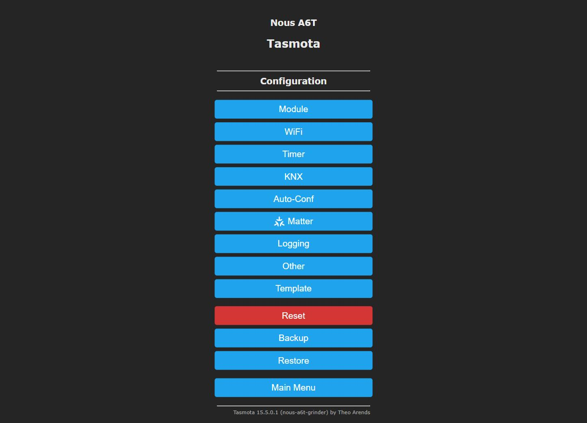
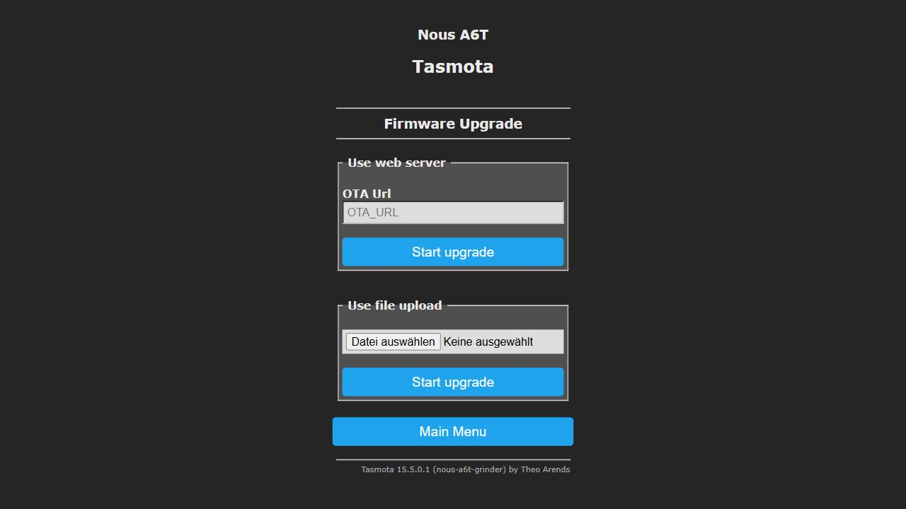

# Set up a new NOUS A6T grinder plug

Connect a new NOUS A6T to your Wi-Fi network, then install the Decent Espresso grinder firmware through its browser interface. You do not need to open the plug, connect a USB cable, or install the NOUS app.

Keep the grinder disconnected throughout setup. Do not open the plug's housing.

If you have already tried setup, go to [Find the plug on your network](#find-the-plug-on-your-network) or [Fix incorrect Wi-Fi details](#fix-incorrect-wi-fi-details). Try Wi-Fi recovery before a factory reset.

The screenshots show our configured test plug. Your network name, IP address, hostname, firmware version, and button labels may differ. Older Tasmota versions use labels such as **Configure WiFi** and **Backup Configuration** instead of **WiFi** and **Backup**.

## 1. Check the plug and prepare your Wi-Fi details

Check that you bought a **NOUS A6T with Tasmota pre-installed**. Do not use this firmware on a similarly named Tuya plug or an ESP8266 model. For other hardware, see [supported devices](../README.md#supported-devices).

Have these ready:

- A phone, tablet, or laptop with Wi-Fi and a browser. A laptop makes the firmware file upload easier.
- Your Wi-Fi network name and password, with **2.4 GHz** enabled on the router. A combined 2.4/5 GHz network name is fine if the router supports the plug's connection.
- Access to your router's connected-device list, in case you need to find the plug's IP address.

Use a password-protected, trusted local network. Avoid public Wi-Fi and guest networks that prevent devices from communicating. Put the HDS scale on the same local network when you pair it later. Do not expose the plug to the internet or forward its ports.

## 2. Power the empty plug

1. Leave the grinder and other appliances unplugged from the NOUS A6T.
2. Insert the NOUS A6T into a mains socket near your router.
3. Open the Wi-Fi settings on your phone or computer.
4. Look for a new network whose name starts with `tasmota-` or `tasmota_`, followed by device-specific letters and numbers.

This is the plug's temporary setup network, not the Wi-Fi network it will use after setup.

## 3. Connect to the plug's setup network

1. Join the `tasmota...` network.
2. If your phone warns that this network has no internet, choose to stay connected. Prevent it from switching to mobile data or another Wi-Fi network during setup.
3. Open [http://192.168.4.1/](http://192.168.4.1/) in the browser. Use `http://`, not `https://`.

Some phones open the setup page as soon as you join the network. If that happens, use that page.

If the setup network disappears before you finish, unplug the empty plug, wait a few seconds, and reconnect it once. Tasmota's Wi-Fi setup window can expire after about three minutes. Do not repeatedly power-cycle it; the factory firmware can interpret that as a reset.

## 4. Enter the Wi-Fi network the plug should join

1. Select your router's Wi-Fi network from the list. If you enter its name by hand, match its spelling and capitalization.
2. Enter that network's password in **WiFi Password**. Do not enter the name of the temporary `tasmota...` network.
3. Leave **WiFi Network 2** empty unless you want to add a backup network.
4. If you see a **Hostname** field, replace `%s-%04d` with a unique name such as `grinder-plug`. Enter only the name, without `http://`, `.local`, or a trailing slash. Use letters, numbers, and hyphens; start and end with a letter or number.
5. Press **Save**. If the page reports a connection failure, check the details and try again on that page. You do not need to reset the plug for a typing mistake.
6. Wait for the connection result. If the page shows the plug's new IP address, write it down.



In this screenshot, `connectbox` is our test network. Enter your own network instead. Leave the password hidden when taking or sharing screenshots.

The initial setup page may omit the Hostname field. In that case, set it after joining your Wi-Fi through **Configuration > WiFi**, as described in [Use or change the hostname](#10-use-or-change-the-hostname).

After a successful connection, the temporary setup network disappears. Losing the browser connection at this point is expected.

### WiFi Network 2

**WiFi Network 2** is an optional second saved network, with its own password. If the active network cannot connect, Tasmota can try the other saved network. The plug connects to one network at a time.

Leave Network 2 empty if you only have one Wi-Fi network. To add a backup after setup:

1. Open **Configuration > WiFi** or **Configure WiFi**.
2. Leave the first network's name and password unchanged.
3. Enter the backup network in **WiFi Network 2** and its password in the second **WiFi Password** field.
4. Press **Save** and wait for the restart.

Use another trusted 2.4 GHz network. The HDS scale must still be able to reach the plug on the same local network after a switch. If the backup is on a different local network, move the scale to that network too.

Do not assume that the plug will switch back to Network 1 as soon as it becomes available. Our grinder firmware disables periodic rescanning while connected, so the plug can stay on a working backup network.

## 5. Rejoin your Wi-Fi and open the plug

1. Reconnect your phone or computer to your normal Wi-Fi network.
2. Open `http://` followed by the plug's new IP address. If you set the hostname to `grinder-plug`, you can also try [http://grinder-plug.local/](http://grinder-plug.local/).
3. If you missed the address, open your router's connected-device list and find the new Tasmota device.

For example, our test plug is at [http://192.168.178.30/](http://192.168.178.30/). Your router will probably assign a different address. `192.168.4.1` is only for the temporary setup network.

You should now see the Tasmota main menu. Keep the grinder disconnected and leave the relay **OFF**.



The screenshot already shows our custom firmware in the footer. A new plug will still show its factory Tasmota version at this stage.

## 6. Secure the web interface and back up the configuration

1. Open **Configuration**, then **Other** or **Configure Other**.
2. Set a **Web Admin Password**, then press **Save**. If the browser asks you to log in, use username `admin` and the password you chose.
3. Return to **Configuration** and press **Backup** or **Backup Configuration**. Keep the downloaded backup somewhere private; it contains your Wi-Fi credentials and other settings.
4. Return to the main menu, open **Information**, and note the installed firmware version and the plug's MAC address.



Keep the factory device template and calibration. Do not select **Reset**, clear the configuration, or replace the template as part of this installation.

The admin password protects the web interface. It does not authenticate the grinder TCP connection, so the trusted-local-network requirement still applies.

## 7. Download our firmware

1. Open the [latest Tasmota Auto Doser release](https://github.com/decentespresso/tasmota-auto-doser/releases/latest).
2. Expand **Assets** if GitHub has collapsed the download list.
3. Download **`tasmota32-nous-a6t-grinder.bin`**.

For the NOUS A6T, use that exact filename. Do not choose the source-code ZIP, the generic `tasmota32-grinder.bin`, an official Tasmota image, or a `.factory.bin` image.

## 8. Upload the firmware and wait for the restart

1. Return to the plug's main menu.
2. Open **Firmware Upgrade**.
3. Find the lower section labelled **Use file upload** or **Upgrade by file upload**.
4. Press **Choose File** and select `tasmota32-nous-a6t-grinder.bin`. Your browser may translate the file-picker button.
5. Press **Start upgrade** in that same file-upload section.
6. Keep the plug powered and leave the browser open while it uploads. Wait for the success message and restart; allow a couple of minutes before reconnecting.
7. Reopen the plug's IP address. If it has changed, find it in the router's connected-device list again.



Do not use the upper web-server upgrade button or the official Tasmota OTA URL. An official Tasmota upgrade replaces our grinder firmware.

A normal web upload preserves your Wi-Fi settings and device hostname. You do not need to repeat Wi-Fi setup after the upgrade.

If the upload reports an error, stop and note the error and the factory firmware version. Older ESP32 firmware can require a different upgrade path because of partition-layout changes. Do not guess at intermediate images or try an ESP8266 minimal image. See [Tasmota ESP32 upgrade notes](https://tasmota.github.io/docs/ESP32/#flashing) or ask for help with the exact version and error.

## 9. Check that our firmware is running

1. Open **Information**, or read the version in the page footer. Look for **`nous-a6t-grinder`**, for example `15.5.0.1(nous-a6t-grinder)`. The Tasmota base version can differ from the GitHub release number.
2. Open **Tools**, then **Console**. On older interfaces, **Console** is on the main menu.
3. Enter `GrinderStatus` and press Enter.
4. Check these fields in the response while no scale is controlling the plug:

| Field | Expected value | Meaning |
| --- | --- | --- |
| `Net.Up` | `1` | The plug has a Wi-Fi connection and an IP address |
| `TCP.Listen` | `1` | Firmware has set its listener startup flag |
| `mDNS.Ad` | `1` | Firmware recorded successful local mDNS registration |
| `Relay.On` | `0` | Software commands the relay OFF |

If you get `Unknown` instead of a `GrinderStatus` response, check that you uploaded our grinder image. If any expected field differs, keep the grinder disconnected and resolve it before use.

These fields report software state. The firmware has no contact feedback and cannot detect welded contacts or prove that the outlet is disconnected from mains.

The listener and mDNS flags do not prove that another device can connect or discover the plug. Confirm communication during HDS pairing before the harmless-load test.

With our firmware, the web **Toggle** button and the plug's physical button cannot turn the grinder outlet on. Only the grinder TCP client can do that. This is expected.

## 10. Use or change the hostname

The **Hostname** is the plug's local network name. It gives you a browser address such as `http://grinder-plug.local/` instead of a numeric IP address. It does not change the Wi-Fi network the plug joins.

The default `%s-%04d` in the Hostname field is a pattern that Tasmota expands into a device-specific name. Do not type that pattern into the browser. To find the resulting name, enter `Status 5` in the console and read `StatusNET.Hostname`.

Our test plug uses [http://tasmota-0B5420-5152.local/](http://tasmota-0B5420-5152.local/). Yours can have a different name.

### Give the plug a simpler hostname

1. Keep the grinder disconnected and open **Configuration > WiFi** or **Configure WiFi**.
2. Leave the Wi-Fi network names and passwords unchanged.
3. Replace the Hostname pattern with `grinder-plug`, or another unique name for this plug.
4. Press **Save** and wait for the restart.
5. On the same local network, open [http://grinder-plug.local/](http://grinder-plug.local/). Substitute your chosen name if you used a different one.

Enter only `grinder-plug` in the field, without `http://`, `.local`, or a trailing slash. Use letters, numbers, and hyphens; start and end with a letter or number. Avoid spaces and underscores. Give each plug a different hostname, for example `grinder-plug-1` and `grinder-plug-2`.

If `.local` lookup does not work on your phone or computer, use the plug's IP address from the router's device list. A hostname does not reserve a fixed IP address; use a DHCP reservation in the router for that.

If you rename a plug that you have paired with an HDS scale, run **Select Plug** on the scale again to refresh its discovery information.

`_grinderplug._tcp.local` is the discovery service type that the scale searches for. It is not a browser address, and the firmware does not rename the plug to `grinderplug.local`.

Setup is complete when you can open the plug on your Wi-Fi network and the checks in step 9 pass. Keep the grinder disconnected while you pair the HDS scale using the [HDS scale setup steps](../README.md#hds-scale-setup). Complete [harmless-load commissioning](grinder-tcp.md#harmless-load-commissioning), including electrical-suitability checks and an independent mains disconnection, before attaching the grinder.

## Find the plug on your network

1. Power the plug with the grinder disconnected. Connect your phone or computer to the same local network.
2. Open your router's administration page or app. Find **Connected devices**, **Home network**, or **DHCP clients**. On a FRITZ!Box, look under **Home Network > Network**; translated labels may differ.
3. Look for your chosen hostname, such as `grinder-plug`, or a device named `tasmota...` if you kept the default. If you recorded its MAC address in step 6, match that address instead of relying on the name. Your router may display the MAC with hyphens rather than colons.
4. Open `http://` followed by the IP address listed for that device. Use the current address, not an old bookmark.
5. Open **Information**, or run `Status 5` in the console, and record the hostname and IP address. Use `http://<hostname>.local/` as another way to reach it when your network supports mDNS.

If you cannot distinguish it from other devices, unplug only this empty plug for 30 seconds, refresh the router's device list, then plug it back in and check which device becomes active. Routers can keep inactive devices in the list, so check their connection status too.

You can reserve the plug's address in your router's DHCP settings to keep an IP bookmark stable. Do not guess a static address in Tasmota; it could conflict with another device.

If the router shows no connection and neither the hostname nor the IP works, use the Wi-Fi recovery steps below. Searching for `_grinderplug._tcp.local` in a browser will not find it.

## Fix incorrect Wi-Fi details

### If you can still open the plug

1. Keep the grinder disconnected.
2. Open **Configuration > WiFi** or **Configuration > Configure WiFi**.
3. Correct **WiFi Network** and **WiFi Password** for the target 2.4 GHz network, then press **Save**.
4. Connect your phone or computer to that target network and find the plug's new address using the router's device list.

You can use these steps to move a working plug to another Wi-Fi network. Change the settings while you still have access through its old network.

### If the setup page reports a connection error

Stay on the `tasmota...` setup network. Correct the network name and password on the page at [http://192.168.4.1/](http://192.168.4.1/) and press **Save** again. Check that the router offers 2.4 GHz Wi-Fi and that the plug has a usable signal.

### If the plug is offline and no setup network appears

With the default Tasmota button settings, six short button presses start Wi-Fi Manager without deleting the device configuration.

1. Disconnect the grinder and leave the plug powered.
2. Press and release the plug's physical button **six times in quick succession**. Keep less than half a second between presses. Do not hold the button down.
3. Wait for a `tasmota...` Wi-Fi network to appear, then join it on your phone or computer.
4. Open [http://192.168.4.1/](http://192.168.4.1/) and enter the correct Wi-Fi details. Press **Save**.
5. Rejoin the target Wi-Fi network and find the plug in the router's connected-device list.
6. Once you can open it again, open the console and enter `WifiConfig 4`. This selects retry mode instead of leaving Wi-Fi Manager as the automatic fallback during a later network outage.
7. If our firmware is installed, repeat the `GrinderStatus` checks in step 9 before reconnecting the grinder.

This method preserves the firmware, template, calibration, and hostname. The grinder power-button restriction in our firmware does not remove this Tasmota Wi-Fi setup action.

The six-press action depends on the stored button settings. `SetOption1 1` disables it, and `SetOption13 1` selects single-press-only behavior. If a previous configuration changed those options, the shortcut may not work. Do not assume that an offline plug will create a setup network on its own: our build's default `WifiConfig 4` keeps retrying the saved network.

## Factory reset as a last resort

**A factory reset erases Wi-Fi credentials, the web password, the device template, calibration, and other Tasmota settings. It keeps the firmware currently installed; it does not reinstall the manufacturer's original firmware.** Prefer the six-button-press Wi-Fi recovery above.

The NOUS manual and Tasmota document a fast power-cycle reset. It requires fast power-cycle recovery to be enabled (`SetOption65 0`, the default). If a previous configuration disabled it, this procedure will not reset the plug.

1. Disconnect the grinder and any other load from the plug.
2. Unplug the NOUS A6T from mains power for **30 seconds**.
3. Plug it in for about **2 seconds**, then unplug it for about **2 seconds**. Repeat this on/off cycle **six times**.
4. Plug it in a **seventh time** and leave it powered. Wait for the reset and startup, then look for the `tasmota...` setup network.
5. Connect to that network and repeat steps 3 to 5 of this guide to join your target Wi-Fi.
6. Restore the plug's configuration before using it with a grinder, as described below.

### Restore the NOUS A6T configuration after a reset

If you have a backup from this same plug, open **Configuration > Restore** or **Restore Configuration**, select that backup, and follow the restore prompts. A backup also restores its saved Wi-Fi details and web password. If those Wi-Fi details no longer work, use the six-press recovery to correct them again.

If you do not have a backup, restore the template for the **NOUS A6T only**:

1. Open **Configuration > Other** or **Configure Other**.
2. Paste this template into the **Template** field:

```json
{"NAME":"Nous A6T","GPIO":[1,1,320,1,32,1,1,1,1,224,2624,1,1,1,1,1,0,1,1,1,0,1,2656,2720,0,0,0,0,1,1,1,1,1,0,0,1],"FLAG":0,"BASE":1}
```

3. Check **Activate**, press **Save**, and wait for the restart. Leave an already checked Activate option checked.
4. Set a web admin password again and make a new configuration backup.
5. If the plug still has factory Tasmota, install our firmware using steps 7 to 9. If it already has `nous-a6t-grinder`, run the checks in step 9; you do not need to reflash it because of the reset.

The template restores the pin configuration, not lost power-monitoring calibration. Restore calibration from your own backup if you need accurate power readings. Grinder dosing uses the HDS scale's weight readings rather than the plug's power measurements.

Keep the grinder disconnected until the firmware checks, an HDS dry test, and [harmless-load commissioning](grinder-tcp.md#harmless-load-commissioning) pass. If reset does not produce a setup network, stop and ask for model-specific recovery help; do not open a mains-powered plug or improvise serial flashing.

## Troubleshooting

| Problem | What to do |
| --- | --- |
| No `tasmota...` setup network | Wait for startup, then reconnect power once and check again within three minutes. If it still does not appear, try the [six-button-press Wi-Fi recovery](#if-the-plug-is-offline-and-no-setup-network-appears) before a factory reset. |
| The Wi-Fi setup page does not open | Stay on the plug's setup network and type `http://192.168.4.1/`. Check whether a VPN or automatic network switching is interfering. |
| The plug cannot join your Wi-Fi | Check the network name and password, 2.4 GHz availability, and signal strength. Follow [Fix incorrect Wi-Fi details](#fix-incorrect-wi-fi-details). |
| The IP address works but `.local` does not | Use the IP address. Local name resolution depends on your client and network. |
| The scale cannot find the plug | Check step 9, put both devices on the same local network, and avoid guest-network isolation. Follow the HDS setup instructions. |

## References

- [NOUS A6T manufacturer setup instructions](https://nous.technology/product/a6t.html?show=manual)
- [Tasmota initial Wi-Fi configuration](https://tasmota.github.io/docs/Getting-Started/#initial-configuration)
- [Tasmota firmware upgrades](https://tasmota.github.io/docs/Upgrading/)
- [Tasmota six-press Wi-Fi setup action](https://tasmota.github.io/docs/Buttons-and-Switches/#multi-press-functions)
- [Tasmota factory reset and power-cycle recovery](https://tasmota.github.io/docs/Device-Recovery/)
- [NOUS A6T device template](https://templates.blakadder.com/nous_A6T.html)
- [Grinder firmware and safety behavior](grinder-tcp.md)
